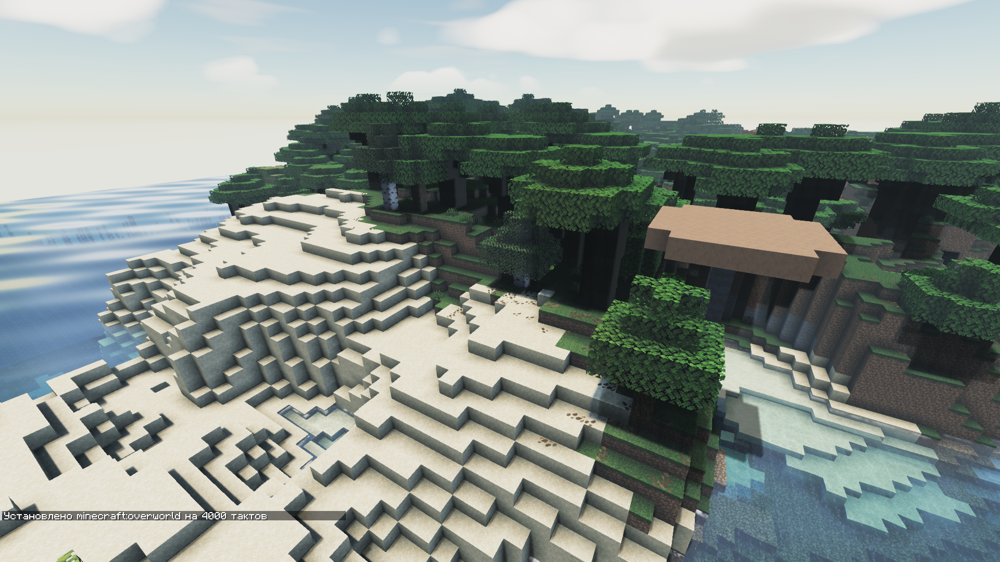
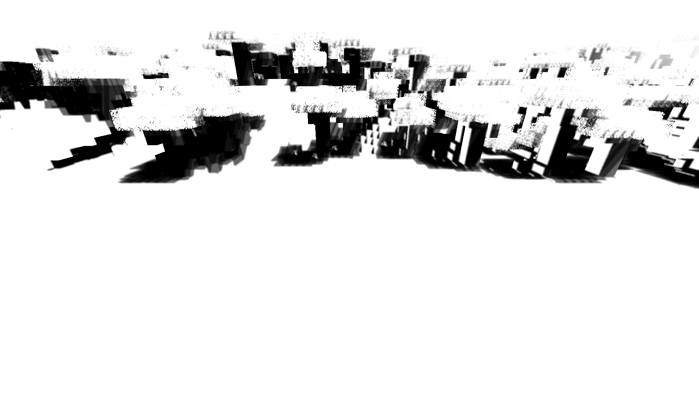
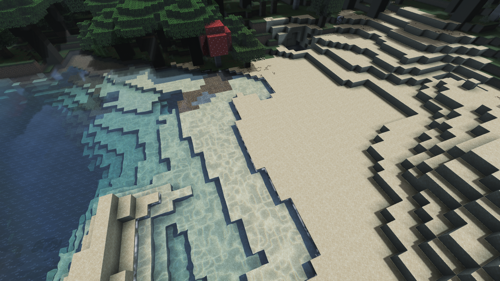
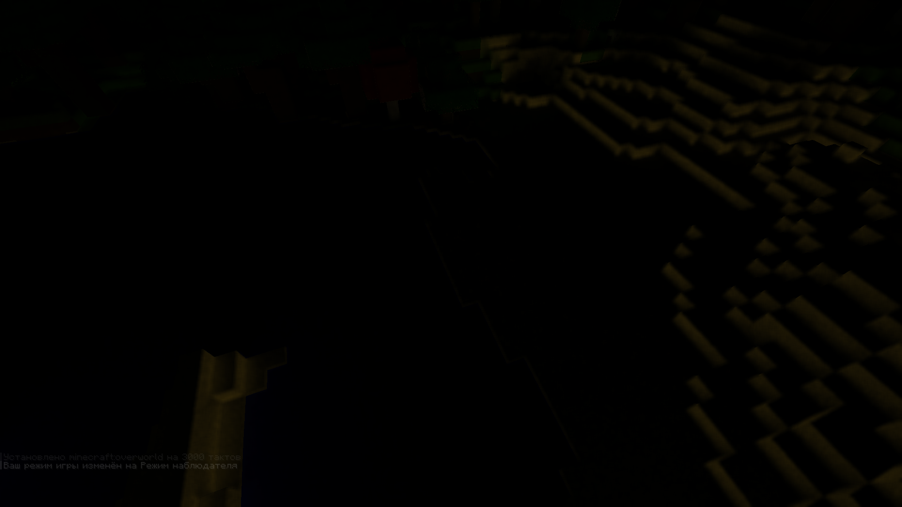

# Zenith Engine

Нативный мод для [Horizon](https://github.com/horizon-rust/horizon) (Minecraft 26.3 на Rust): второй «движок» для шейдера [Zenith](https://github.com/scomicon/Zenith), который запускает свои проходы на видеокарте без лимитов Horizon Shader API. Идея та же, что у связки Focal Engine + Continuum, но реализация своя, с нуля, на открытых точках расширения Horizon.

**Статус: прототип.** Он проверяет, что архитектура работает, а не даёт новую картинку. Проверен в игре 2026-11-24 на `nightly-2026-11-22-f1bb66f` вместе с Zenith RT (RX 7600, Vulkan): буфер на 64 МиБ прошёл проверку, глубина мира читается, воксельная сцена строится, тени от солнца следуют за временем суток и накладываются на всю картинку.

## Как это устроено

- Zenith остаётся обычным шейдер-паком и рисует основу: материалы, небо, тени.
- Мод подключается к официальной точке `horizon_mod_render::render::world_drawn`. Её вызывают после отрисовки мира и пака, до руки и HUD. Мод получает `wgpu`-устройство, энкодер, картинку, глубину и матрицы.
- **Своя воксельная сцена.** RT-сцена движка (TLAS) моду недоступна, поэтому мод строит свою:
  - хук `add_section_geometry` на потоках мешера читает блоки каждой секции 16³;
  - `client_tick_post` переводит их в байты вокселей: твёрдый ли блок, светится ли, цвет по map color;
  - проход мода держит вокруг камеры 3D-текстуру 256³ и подгружает в неё секции.
- Лучи идут по вокселям (DDA), аппаратные лучевые запросы не нужны. Поэтому сцена работает и с обычным Zenith, а не только с Zenith RT.
- Подробности: [docs/ARCHITECTURE.md](docs/ARCHITECTURE.md).

## Что делает мод

**Тени от солнца по воксельной сцене на всю картинку.**

- Луч к солнцу идёт из каждого пикселя по вокселям. Нормаль поверхности восстанавливается по глубине, и луч стартует чуть над поверхностью.
- Листва пропускает часть света, а не перекрывает его целиком. Трава и цветы тени не отбрасывают.
- Маска сглаживается фильтром 5×5 с учётом глубины и умножается на картинку Zenith.
- К краю воксельного окна (96–120 блоков) тени плавно гаснут.

**Как включить:** в меню Zenith или Zenith RT, на странице «Shadows», включите опцию **Zenith Engine Shadows**. Пак перестаёт затенять солнечный свет в радиусе ~100 блоков, а мод, увидев эту опцию в сохранённых значениях пака, начинает рисовать тени сам. Тени не накладываются дважды. Дальше 96–120 блоков возвращаются тени пака.

Настройки мода лежат в `config/zenith_engine.txt` в папке игры. Файл создаётся при первом запуске и перечитывается раз в секунду:

| Ключ | Значение |
|---|---|
| `shadows` | `auto` (по умолчанию) — по опции Zenith Engine Shadows в паке; `on`; `off`; `mask` — показать только маску теней |
| `shadow_strength` | на сколько умножается полностью затенённый пиксель, от 0 до 1. По умолчанию 0.45: так же темна тень самого Zenith (замер на песке, Zenith RT Ultra, 8 утра) |

Мод не затеняет то, где нет небесного света (пещеры, закрытые комнаты), и поверхности, повёрнутые от солнца: там свет уже убрал пак.

| Тени Zenith RT | Опция включена: тени рисует мод |
|---|---|
|  |  |

| Без мода | Мод поверх теней пака (опция выключена, `shadows = on`) |
|---|---|
|  |  |



**Глобальное освещение (GI), один отскок солнечного света.**

- В половинном разрешении из каждого пикселя идут два луча, распределённых по косинусу, на расстояние до 48 блоков по вокселям.
- Если луч попал в блок, освещённый солнцем (это проверяет его собственный луч к солнцу), он приносит свет цвета этого блока. Цвета — vanilla map color, таблица `MAP_COLORS`.
- Результат накапливается по кадрам с репроекцией и проверкой расстояния, сглаживается фильтром 5×5 по глубине.
- В картинку он прибавляется с учётом цвета блока под пикселем.
- В результате теневые грани рядом с освещённым песком становятся тёплыми, песочного цвета, а земля под открытым небом почти не меняется: её лучи уходят в небо.

| Без GI | С GI | Только GI (`gi = debug`) |
|---|---|---|
|  |  |  |

Настройки GI в том же файле:

| Ключ | Значение |
|---|---|
| `gi` | `auto` (по умолчанию) — вместе с тенями мода, кроме Zenith RT в режиме Full RT, где у пака свой GI; `on`; `off`; `debug` — только отражённый свет |
| `gi_strength` | сколько отражённого света прибавить, от 0 до 4 (по умолчанию 0.6) |

**Известные недостатки:**
- Тени накладываются на уже готовую картинку (после тонмаппинга пака), а не в освещение. Поэтому в тени темнеет и свет факелов.
- Сущности не отбрасывают тени мода: их нет в воксельной сцене. Тени от сущностей рисует пак, но при включённой опции только дальше ~100 блоков.
- Тени: около 4 мс GPU на 1920×1080 (RX 7600). Стоимость GI отдельно не измерена: проходы мода не выделяются в счётчиках `gpu-passes`.
- GI учитывает только солнце и луну: свет от блоков (факелы, лава) и небо как источник пока не отражаются. Цвета блоков — усреднённые map color, а не текстуры.

## Сборка

Мод привязан к сборке Horizon `nightly-2026-11-22-f1bb66f` (`[native]` в `mod/horizon-mod.toml`). Собирает его сам лаунчер:

```
horizon-launcher native-build mod --instance <экземпляр> --version nightly-2026-11-22-f1bb66f --trust-native-code
```

Нативный код выполняется с правами игрока и вне песочницы.

## Лицензия

Пока не выбрана.

