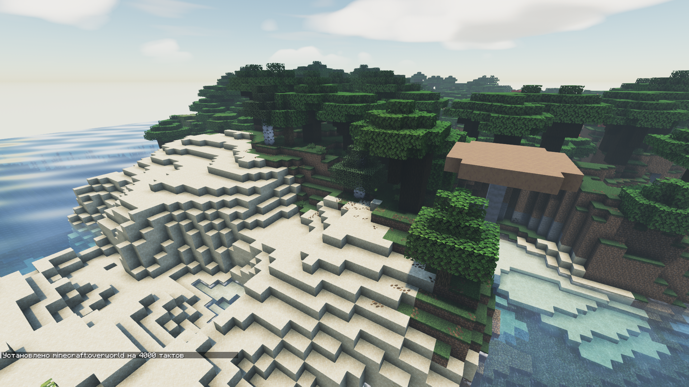

# Zenith Engine

Нативный мод для [Horizon](https://github.com/horizon-rust/horizon) (Minecraft 26.3 на Rust): второй «движок» для шейдера [Zenith](https://github.com/scomicon/Zenith), который запускает свои проходы на видеокарте без лимитов Horizon Shader API. Идея та же, что у связки Focal Engine + Continuum, но реализация своя, с нуля, на открытых точках расширения Horizon.

**Статус: прототип.** Он проверяет, что архитектура работает, а не даёт новую картинку. Проверен в игре 2026-11-24 на `nightly-2026-11-22-f1bb66f` вместе с Zenith RT (RX 7600, Vulkan): буфер на 64 МиБ прошёл проверку, глубина мира читается, воксельная сцена строится, тени от солнца следуют за временем суток и накладываются на всю картинку.

## Как это устроено

- Zenith остаётся обычным шейдер-паком и рисует основу: материалы, небо, тени.
- Мод подключается к официальной точке `horizon_mod_render::render::world_drawn`. Её вызывают после отрисовки мира и пака, до руки и HUD. Мод получает `wgpu`-устройство, энкодер, картинку, глубину и матрицы.
- **Своя воксельная сцена.** RT-сцена движка (TLAS) моду недоступна, поэтому мод строит свою:
  - хук `add_section_geometry` на потоках мешера читает блоки каждой секции 16³;
  - `client_tick_post` переводит их в байты вокселей: твёрдый ли блок, светится ли, цвет по map color;
  - проход мода держит вокруг камеры 3D-текстуру 256³ и подгружает в неё секции.
- Лучи идут по вокселям (DDA), аппаратные лучевые запросы не нужны. Поэтому сцена работает и с обычным Zenith, а не только с Zenith RT.
- Подробности: [docs/ARCHITECTURE.md](docs/ARCHITECTURE.md).

## Что делает мод

**Тени от солнца по воксельной сцене на всю картинку.**

- Луч к солнцу идёт из каждого пикселя по вокселям. Нормаль поверхности восстанавливается по глубине, и луч стартует чуть над поверхностью.
- Листва пропускает часть света, а не перекрывает его целиком. Трава и цветы тени не отбрасывают.
- Маска сглаживается фильтром 5×5 с учётом глубины и умножается на картинку Zenith.
- К краю воксельного окна (96–120 блоков) тени плавно гаснут.

Настройки лежат в `config/zenith_engine.txt` в папке игры. Файл создаётся при первом запуске и перечитывается раз в секунду:

| Ключ | Значение |
|---|---|
| `shadows` | 0 — выкл., 1 — тени поверх картинки, 2 — только маска (для отладки) |
| `shadow_strength` | на сколько умножается полностью затенённый пиксель, от 0 до 1 (по умолчанию 0.55) |

| Без мода | С тенями мода |
|---|---|
|  |  |


**Известные недостатки:**
- Zenith рисует свои тени, и мод умножает картинку поверх них. Там, где тени совпадают, затемнение двойное. Правильное решение — опция в Zenith, которая отдаёт солнечные тени движку.
- Тени накладываются на уже готовую картинку (после тонмаппинга пака), а не в освещение.
- Около 4 мс GPU на 1920×1080 (RX 7600): кадр с Zenith RT Ultra вырос с ~41,7 до ~45,5 мс.

## Сборка

Мод привязан к сборке Horizon `nightly-2026-11-22-f1bb66f` (`[native]` в `mod/horizon-mod.toml`). Собирает его сам лаунчер:

```
horizon-launcher native-build mod --instance <экземпляр> --version nightly-2026-11-22-f1bb66f --trust-native-code
```

Нативный код выполняется с правами игрока и вне песочницы.

## Лицензия

Пока не выбрана.

