# Zenith Engine

Нативный мод для [Horizon](https://github.com/horizon-rust/horizon) (Minecraft 26.3 на Rust): второй «движок» для шейдеров. Он трассирует лучи по своей воксельной копии мира и добавляет к картинке шейдер-пака тени от солнца, отражённый свет (GI) и отражения в воде, не упираясь в лимиты Horizon Shader API. Идея та же, что у связки Focal Engine + Continuum, но реализация своя, с нуля, на открытых точках расширения Horizon. Сделан в паре с паком [Zenith](https://github.com/scomicon/Zenith), но рассчитан на любой пак.

**Статус: ранняя версия.** Всё ниже проверено в игре 2026-11-24 на `nightly-2026-11-22-f1bb66f` с Zenith RT (RX 7600, Vulkan); совместимость с другими паками и без пака — в разделе «С другими шейдерами».

## Что умеет

| Эффект | Как устроен |
|---|---|
| **Тени от солнца** на всю картинку | луч к солнцу из каждого пикселя по вокселям; нормаль из глубины; листва пропускает 40% света, трава и цветы тени не отбрасывают; фильтр 5×5 по глубине |
| **GI: отражённый свет солнца и блоков** | два луча на пиксель в половинном разрешении; освещённые солнцем или факелами блоки отдают свет своего цвета; накопление по кадрам с репроекцией; яркость берётся из самой картинки, поэтому от экспозиции пака результат не зависит |
| **Своя сцена для лучей** | воксельная 3D-текстура 256³ вокруг камеры: блоки, средний цвет верхней и боковой текстуры каждого блока (с подкраской биома), небесный свет и свет от блоков. Свет между клетками сглажен, как в vanilla. Аппаратный RT не нужен |
| **Тени от мобов и игроков** | по частям модели: ноги, тело, голова — каждая своей коробкой, поэтому у лошади видны шея и ноги |
| **Объёмные тени** | 16 точек вдоль луча взгляда (четверть разрешения) проверяют солнце по вокселям; доля воздуха в тени затемняет дымку: тёмные полосы в освещённом воздухе, в том числе на фоне неба |
| **Отражения в воде**, и того, что за краем экрана | луч от поверхности воды отражается вверх по вокселям; если блок виден на экране, берётся цвет из кадра, если нет, мод сам освещает его цвет и подгоняет яркость и насыщенность под кадр пака; смешивается по Френелю; пять бегущих волн дают рябь |

| Тени Zenith RT | Тени рисует мод (опция Zenith Engine Shadows) |
|---|---|
| 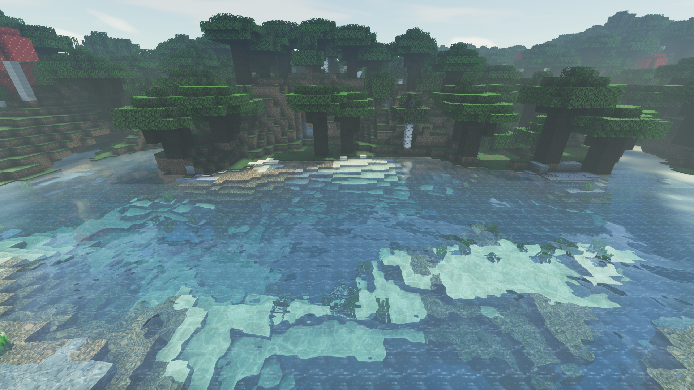 | 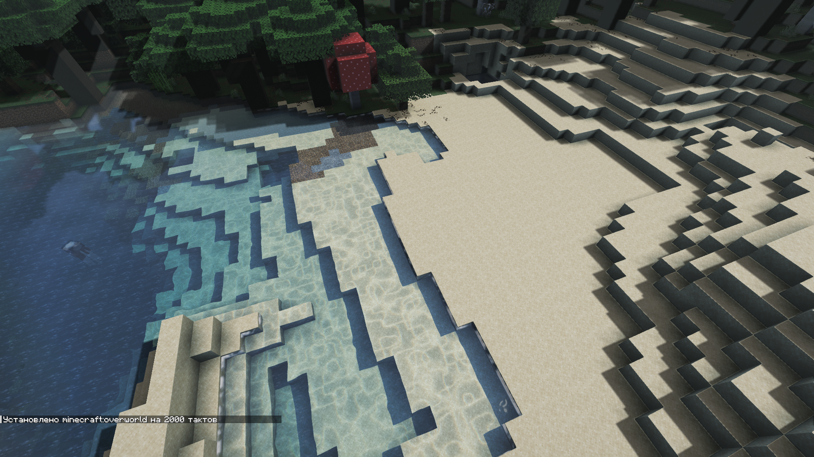 |

| Без GI | С GI: теневые грани ступеней получили тёплый свет от песка |
|---|---|
|  |  |

| Без GI | С GI: свет факелов отражается от красной стены на потолок и стены |
|---|---|
| 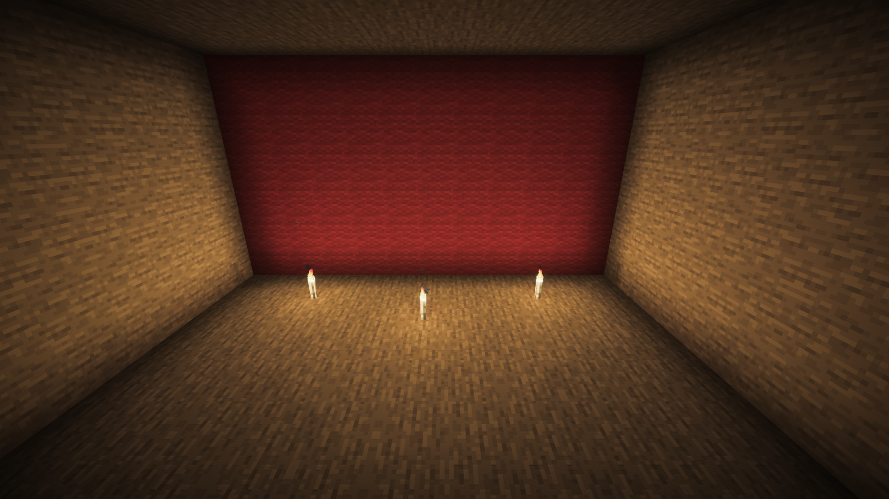 |  |

| Без GI | С GI: лава и светокамень светят на стены |
|---|---|
|  | 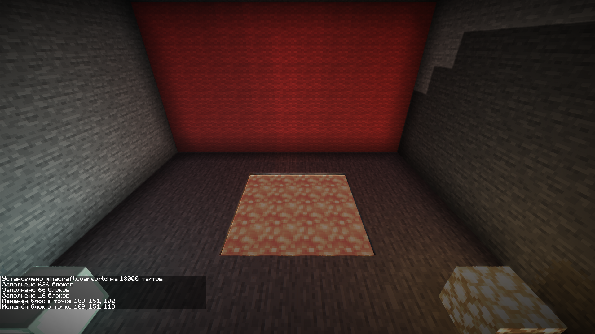 |

| Один отскок (`gi_bounces = 0`) | Многократные отскоки через кэш излучения |
|---|---|
| 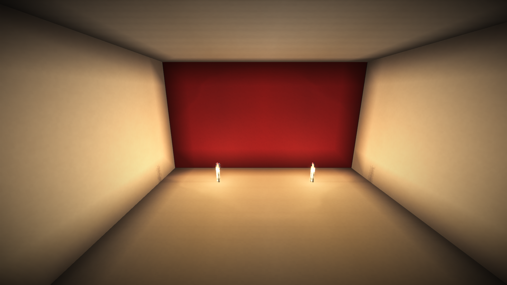 | 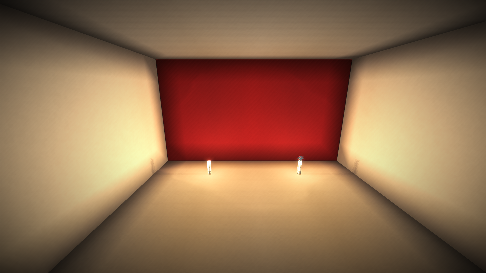 |

| Отражения пака | С отражениями мода (`reflections = 1`, по умолчанию): деревья и гриб отражаются в озере |
|---|---|
| 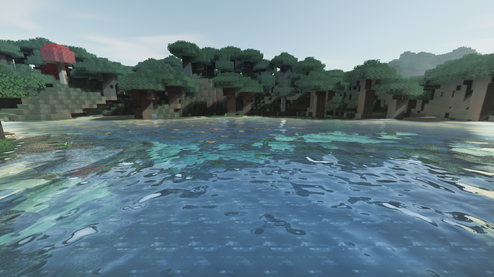 | 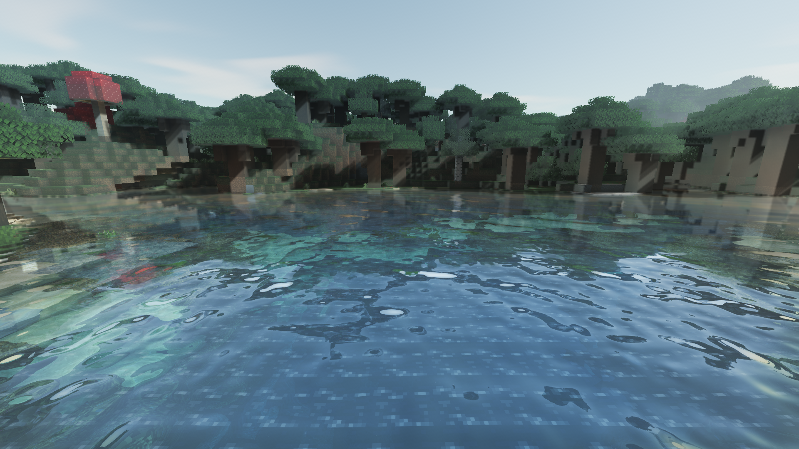 |

| Отражения пака: башни видны в воде только у дальнего края | Мод (`reflections = 2`): отражается и верх башен, которого нет на экране |
|---|---|
| 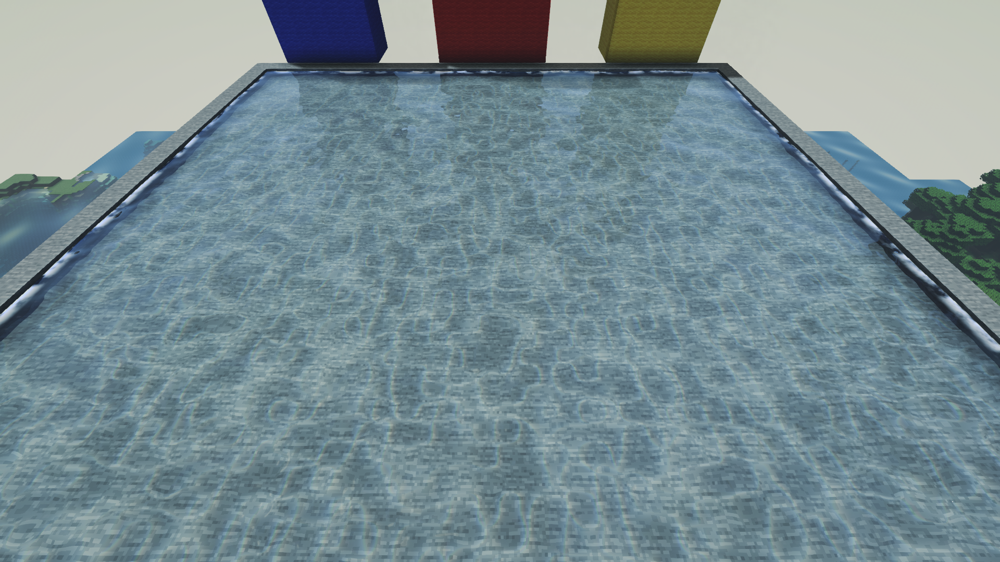 | 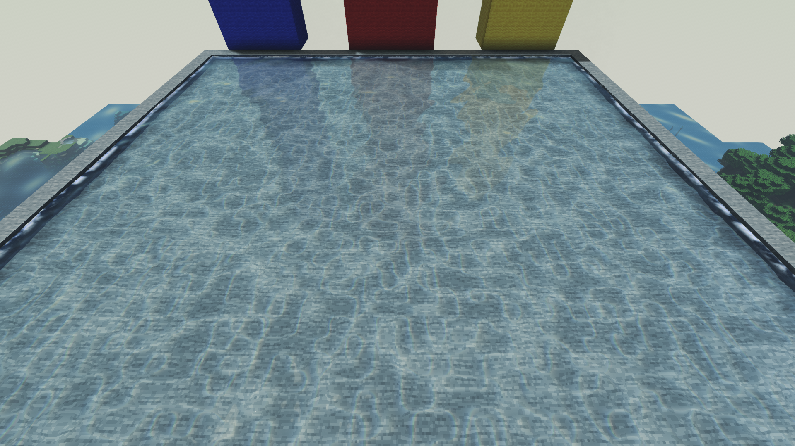 |

| Зеркало (`reflection_ripples = 0`) | Рябь (`reflection_ripples = 1`, по умолчанию; оба кадра с `reflections = 2`) |
|---|---|
| 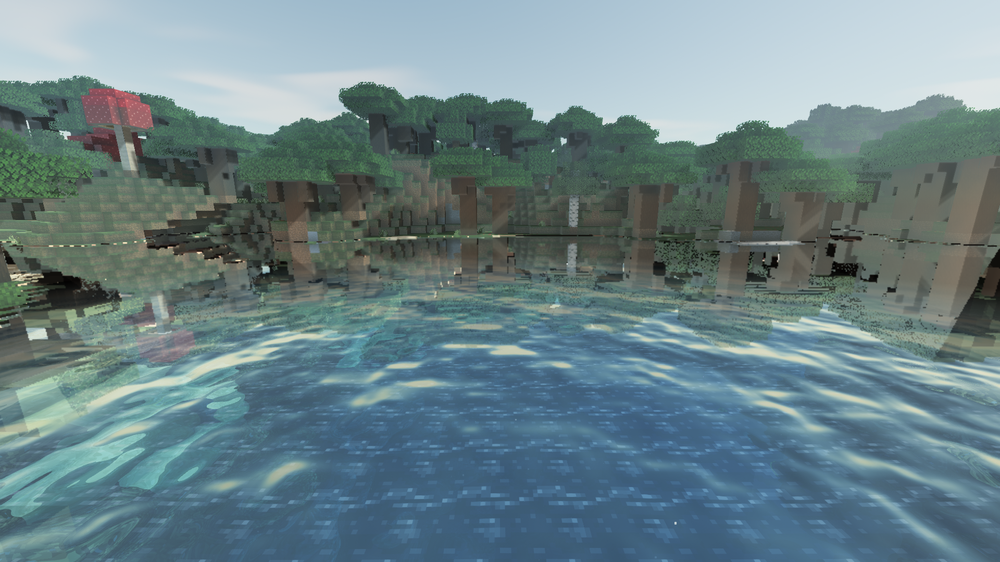 | 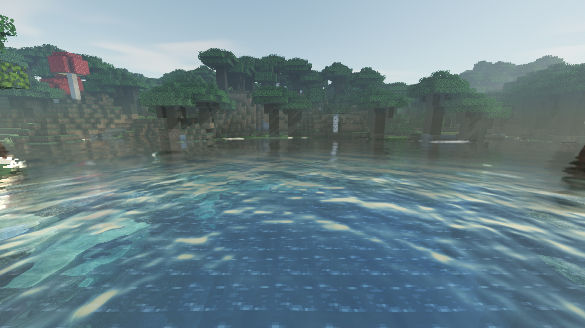 |

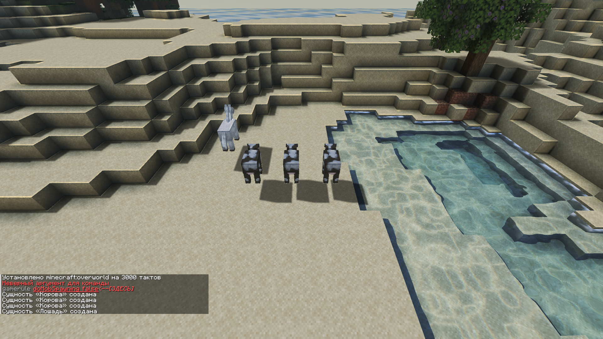


## Преимущества перед обычным шейдер-паком

| | Шейдер-пак (Horizon Shader API) | Zenith Engine |
|---|---|---|
| Память на ресурс | до 32 МиБ | без лимита API |
| Ресурсы и проходы | 8 ресурсов, 6 полноэкранных целей, 12 post-проходов | сколько потянет видеокарта |
| Бюджет кадра | 16 мс GPU, лимиты на выражения и размер WGSL | нет |
| Лучи | только TLAS движка: 8 чанков, только с `[ray_tracing]` | своя воксельная сцена, работает без RT-видеокарты |
| Данные о мире | что даёт API | всё из mod_api: блоки, их свойства, цвета, небесный свет, свет от блоков, время суток |

Цена: мод рисует поверх готового кадра, привязан к конкретной сборке Horizon, а игрок должен разрешить нативный код.

## Как включить с Zenith

1. Установите мод (см. «Сборка») и пак Zenith или Zenith RT.
2. В меню пака на странице **Shadows** включите **Zenith Engine Shadows**. Пак перестанет затенять солнечный свет в радиусе ~100 блоков, а мод это увидит и начнёт рисовать тени и GI сам. Тени не накладываются дважды, а дальше 96–120 блоков возвращаются тени пака.

## С другими шейдерами

Мод рассчитан на **любой** пак и даже на игру без пака: он подключается к `world_drawn` после отрисовки мира и не зависит от кода пака. 2026-11-24 он проверен в игре без пака и с пятью паками-примерами из SDK Horizon (`crates/horizon-shader-api/packs`): ошибок и вылетов нет ни с одним, у всех работают все проходы.

| Пак | По умолчанию (`auto`) | С `shadows = on`, `gi = on` |
|---|---|---|
| Без пака (vanilla) | отражения в воде: деревья с рябью там, где vanilla-вода ничего не отражает | тени от крон и тёплый отражённый свет; выглядит естественно |
| Golden Hour | отражения | тени и GI поверх его цветокоррекции, без наложений |
| Horizon HDR | отражения | тени и GI, без наложений |
| Traced Shadows | отражения; тени рисует пак | **двойные тени**: пак уже затенил, мод затемняет ещё раз. Тени мода с этим паком не включайте |
| Traced Water | отражения мода ложатся поверх зеркальных отражений пака: у берега заметно двоение. С этим паком лучше `reflections = 0` | то же |
| Traced Lights | отражения | тени и GI, без наложений |
| Zenith, Zenith RT | всё, при включённой в паке опции Zenith Engine Shadows | — |

- **Пак с опцией `engine_shadows`.** Режим `auto` включается сам, как с Zenith. Чтобы пак работал с движком так же, как Zenith, ему достаточно объявить bool-опцию `engine_shadows`. Когда она включена, пак не затеняет солнечный свет в радиусе 96 блоков (от 96 до 120 блоков его тени плавно возвращаются). Пример: `mat_engine_shadows` в Zenith.
- **Пак без своих теней** (vanilla, Golden Hour, Horizon HDR, Traced Lights). `shadows = on` и `gi = on` добавляют тени и отражённый свет без оговорок: яркость GI берётся из картинки пака.
- **Пак со своими тенями солнца** (Traced Shadows и др.). Тени мода лягут поверх теней пака, и там, где они совпадут, будет двойное затемнение. Оставьте `shadows = auto` (тогда тени рисует пак) или выключите тени в самом паке.
- **Пак со своими отражениями воды по лучам** (Traced Water, Full RT). Мод не знает, отражает ли пак воду сам (у пака нет такого протокола), и по умолчанию добавляет свои отражения. Если видно двоение, поставьте `reflections = 0`.

## Проходы для авторов паков

Пак может дать движку свои полноэкранные проходы. Они лежат рядом с паком в `shaderpacks/.zenith-engine/<id пака>/` и получают воксели, свет, GI и маску теней мода без лимитов API. Файлы перечитываются на лету, а ошибка в шейдере отключает проход, не роняя игру. Подробности и пример: [docs/PACK-PASSES.md](docs/PACK-PASSES.md).

## Настройки

Файл `config/zenith_engine.txt` в папке игры. Он создаётся при первом запуске и перечитывается раз в секунду, перезапуск не нужен.

| Ключ | Значение |
|---|---|
| `shadows` | `auto` (по умолчанию) — когда у выбранного пака включена опция `engine_shadows`; `on`; `off`; `mask` — только маска теней |
| `shadow_strength` | на сколько умножается полностью затенённый пиксель, 0–1. По умолчанию 0.45: так же темна тень самого Zenith (замер на песке, Zenith RT Ultra, 8 утра) |
| `gi` | `auto` (по умолчанию) — вместе с тенями мода, кроме Zenith RT в режиме Full RT, где у пака свой GI; `on`; `off`; `debug` — только отражённый свет |
| `gi_strength` | сколько отражённого света прибавить, 0–4. По умолчанию 1, физически ровно |
| `gi_block_light` | насколько ярок свет факелов и лавы в отскоке по сравнению с солнцем (1), 0–4. По умолчанию 1.2 |
| `gi_emissive` | насколько ярко светящиеся блоки (лава, светокамень) светят через лучи, 0–8. По умолчанию 1.5 |
| `gi_bounces` | сколько света прошлых отскоков (кэш излучения) приносят лучи, 0 (один отскок) – 1. По умолчанию 0.7 |
| `volumetrics` | насколько воздух в тени затемняет дымку (лучи), 0 (выкл.) – 1. По умолчанию 0.35, работает вместе с тенями мода |
| `reflections` | сила отражений в воде, 0 (выкл.) – 4. По умолчанию 1 — коэффициент Френеля воды; работает с любым паком, независимо от теней мода |
| `reflection_ripples` | насколько волны искажают отражения, 0 (зеркало) – 4. По умолчанию 1 |
| `skip_empty` | `on` (по умолчанию): лучи перепрыгивают пустые кубы 4³ и секции 16³; `off` — шаг по каждой клетке, только для сравнения |
| `gi_sky` | насколько видимое лучами небо затемняет места, которые vanilla-свет неба считает открытыми (навесы), 0–1. По умолчанию 0: у Zenith своё затенение неба (AO и RT-освещение), и вместе они затемняли рельеф дважды. Имеет смысл для паков без AO |

## Известные недостатки

- **Наложение на готовый кадр.** Тени ложатся после тонмаппинга пака. Свет факелов в тени мода сохраняется: тень ослабевает там, где есть свет от блоков, но это оценка по уровню света, а не точное разделение света пака.
- **Сущности.** Тень моба собирается из коробок частей модели (повёрнутая часть даёт чуть большую коробку), не больше 448 частей на кадр. В GI и отражениях сущностей нет.
- **GI.** Многократные отскоки идут через грубый кэш излучения (зонды через 2 блока), поэтому вторичный свет мягкий и сходится за несколько секунд после изменений. Денойзер — два прохода à-trous поверх накопления по кадрам.
- **Цвета блоков.** Два средних цвета на блок (верхняя и боковая грань, подкраска биома по месту камеры при первой встрече блока), а не текстура целиком. После смены ресурспака (F3+T) цвета читаются заново по мере того, как игра перестраивает секции.
- **Стоимость** на 1920×1080, RX 7600, Zenith RT Ultra, у озера в лесу, по собственным timestamp-запросам мода (в скобках — без пропуска пустоты, `skip_empty = off`): трассировка теней 0,83 мс (3,64), трассировка GI 1,42 мс (4,07), объёмные тени 0,80 мс (1,21), отражения 0,28 мс (0,70), кэш излучения 0,07 мс, наложение теней 0,21 мс, наложение GI 0,26 мс, остальное меньше 0,1 мс; всего около 4 мс GPU, CPU мода около 1 мс. Мод пишет эти средние в лог игры раз в 2 секунды (`zenith_engine timing`).
- **Отражения.** Только вода. Высота поверхности считается ровной (8/9 блока), а рябь своя: пять бегущих волн мода, а не волны пака, поэтому блики пака и изгибы отражения не совпадают. Отражение считается в половинном разрешении и смешивается билинейно; при сильной ряби у берега края всё равно мягче, чем у пака. Небо отражает сам пак: мод рисует только попадания в блоки. За краем экрана блок окрашен одним средним цветом грани (верх или бок), а освещение мода приближённое: солнце, свет от блоков и рассеянный свет из кэша GI (без GI — vanilla-свет неба), подогнанные под кадр по яркости и насыщенности. Трава и цветы не отражаются, как и сущности.
- **Дальность.** Дальше 120 блоков от камеры эффекты гаснут: столько охватывает воксельное окно.

## Сборка

Мод привязан к сборке Horizon `nightly-2026-11-22-f1bb66f` (`[native]` в `mod/horizon-mod.toml`). Собирает его сам лаунчер:

```
horizon-launcher native-build mod --instance <экземпляр> --version nightly-2026-11-22-f1bb66f --trust-native-code
```

Нативный код выполняется с правами игрока и вне песочницы. Как всё устроено внутри: [docs/ARCHITECTURE.md](docs/ARCHITECTURE.md).

## Лицензия

MIT, см. [LICENSE](LICENSE).
