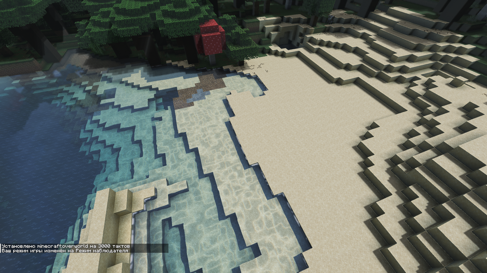
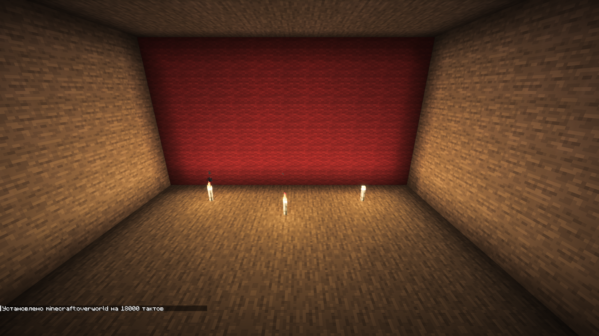
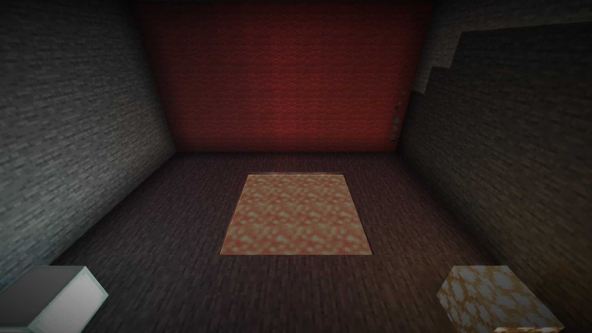

# Zenith Engine

Нативный мод для [Horizon](https://github.com/horizon-rust/horizon) (Minecraft 26.3 на Rust): второй «движок» для шейдеров. Он трассирует лучи по своей воксельной копии мира и добавляет к картинке шейдер-пака тени от солнца и отражённый свет (GI), не упираясь в лимиты Horizon Shader API. Идея та же, что у связки Focal Engine + Continuum, но реализация своя, с нуля, на открытых точках расширения Horizon. Сделан в паре с паком [Zenith](https://github.com/scomicon/Zenith), но рассчитан на любой пак.

**Статус: ранняя версия.** Всё ниже проверено в игре 2026-11-24 на `nightly-2026-11-22-f1bb66f` с Zenith RT (RX 7600, Vulkan).

## Что умеет

| Эффект | Как устроен |
|---|---|
| **Тени от солнца** на всю картинку | луч к солнцу из каждого пикселя по вокселям; нормаль из глубины; листва пропускает 40% света, трава и цветы тени не отбрасывают; фильтр 5×5 по глубине |
| **GI: отражённый свет солнца и блоков** | два луча на пиксель в половинном разрешении; освещённые солнцем или факелами блоки отдают свет своего цвета; накопление по кадрам с репроекцией; яркость берётся из самой картинки, поэтому от экспозиции пака результат не зависит |
| **Своя сцена для лучей** | воксельная 3D-текстура 256³ вокруг камеры: блоки, средний цвет текстуры каждого блока (с подкраской биома), небесный свет и свет от блоков. Свет между клетками сглажен, как в vanilla. Аппаратный RT не нужен |
| **Тени от мобов и игроков** | коробка вокруг модели каждого моба и игрока проверяется лучом тени |
| **Объёмные тени** | 16 точек вдоль луча взгляда (четверть разрешения) проверяют солнце по вокселям; доля воздуха в тени затемняет дымку: тёмные полосы в освещённом воздухе, в том числе на фоне неба |

| Тени Zenith RT | Тени рисует мод (опция Zenith Engine Shadows) |
|---|---|
|  |  |

| Без GI | С GI: теневые грани ступеней получили тёплый свет от песка |
|---|---|
|  |  |

| Без GI | С GI: свет факелов отражается от красной стены на потолок и стены |
|---|---|
|  |  |

| Без GI | С GI: лава и светокамень светят на стены |
|---|---|
|  |  |

| Один отскок (`gi_bounces = 0`) | Многократные отскоки через кэш излучения |
|---|---|
|  |  |


## Преимущества перед обычным шейдер-паком

| | Шейдер-пак (Horizon Shader API) | Zenith Engine |
|---|---|---|
| Память на ресурс | до 32 МиБ | без лимита API |
| Ресурсы и проходы | 8 ресурсов, 6 полноэкранных целей, 12 post-проходов | сколько потянет видеокарта |
| Бюджет кадра | 16 мс GPU, лимиты на выражения и размер WGSL | нет |
| Лучи | только TLAS движка: 8 чанков, только с `[ray_tracing]` | своя воксельная сцена, работает без RT-видеокарты |
| Данные о мире | что даёт API | всё из mod_api: блоки, их свойства, цвета, небесный свет, свет от блоков, время суток |

Цена: мод рисует поверх готового кадра, привязан к конкретной сборке Horizon, а игрок должен разрешить нативный код.

## Как включить с Zenith

1. Установите мод (см. «Сборка») и пак Zenith или Zenith RT.
2. В меню пака на странице **Shadows** включите **Zenith Engine Shadows**. Пак перестанет затенять солнечный свет в радиусе ~100 блоков, а мод это увидит и начнёт рисовать тени и GI сам. Тени не накладываются дважды, а дальше 96–120 блоков возвращаются тени пака.

## С другими шейдерами

Мод рассчитан на **любой** пак и даже на игру без пака: он подключается к `world_drawn` после отрисовки мира и не зависит от кода пака. **В игре проверен только с Zenith RT**: работу с другими паками и без пака я не проверял.

- **Пак с опцией `engine_shadows`.** Режим `auto` включается сам, как с Zenith. Чтобы пак работал с движком так же, как Zenith, ему достаточно объявить bool-опцию `engine_shadows`. Когда она включена, пак не затеняет солнечный свет в радиусе 96 блоков (от 96 до 120 блоков его тени плавно возвращаются). Пример: `mat_engine_shadows` в Zenith.
- **Любой другой пак.** Включите эффекты вручную: `shadows = on`, `gi = on`. Тени мода лягут поверх теней пака, и там, где они совпадут, будет двойное затемнение. Поможет `shadow_strength` поближе к 1 или выключенные тени в самом паке. GI работает без оговорок: его яркость берётся из картинки пака.
- **Без шейдер-пака.** `shadows = on` и `gi = on` дают vanilla-картинке тени и отражённый свет.

## Проходы для авторов паков

Пак может дать движку свои полноэкранные проходы. Они лежат рядом с паком в `shaderpacks/.zenith-engine/<id пака>/` и получают воксели, свет, GI и маску теней мода без лимитов API. Файлы перечитываются на лету, а ошибка в шейдере отключает проход, не роняя игру. Подробности и пример: [docs/PACK-PASSES.md](docs/PACK-PASSES.md).

## Настройки

Файл `config/zenith_engine.txt` в папке игры. Он создаётся при первом запуске и перечитывается раз в секунду, перезапуск не нужен.

| Ключ | Значение |
|---|---|
| `shadows` | `auto` (по умолчанию) — когда у выбранного пака включена опция `engine_shadows`; `on`; `off`; `mask` — только маска теней |
| `shadow_strength` | на сколько умножается полностью затенённый пиксель, 0–1. По умолчанию 0.45: так же темна тень самого Zenith (замер на песке, Zenith RT Ultra, 8 утра) |
| `gi` | `auto` (по умолчанию) — вместе с тенями мода, кроме Zenith RT в режиме Full RT, где у пака свой GI; `on`; `off`; `debug` — только отражённый свет |
| `gi_strength` | сколько отражённого света прибавить, 0–4. По умолчанию 1, физически ровно |
| `gi_block_light` | насколько ярок свет факелов и лавы в отскоке по сравнению с солнцем (1), 0–4. По умолчанию 1.2 |
| `gi_emissive` | насколько ярко светящиеся блоки (лава, светокамень) светят через лучи, 0–8. По умолчанию 1.5 |
| `gi_bounces` | сколько света прошлых отскоков (кэш излучения) приносят лучи, 0 (один отскок) – 1. По умолчанию 0.7 |
| `volumetrics` | насколько воздух в тени затемняет дымку (лучи), 0 (выкл.) – 1. По умолчанию 0.35, работает вместе с тенями мода |
| `gi_sky` | насколько видимое лучами небо затемняет места, которые vanilla-свет неба считает открытыми (навесы), 0–1. По умолчанию 0.5 |

## Известные недостатки

- **Наложение на готовый кадр.** Тени ложатся после тонмаппинга пака, поэтому в тени мода темнеет и свет факелов.
- **Сущности.** Тень моба — тень его коробки (прямоугольник), а не силуэт. В GI сущности не участвуют.
- **GI.** Многократные отскоки идут через грубый кэш излучения (зонды через 2 блока), поэтому вторичный свет мягкий и сходится за несколько секунд после изменений. Денойзер — два прохода à-trous поверх накопления по кадрам.
- **Цвета блоков.** Один средний цвет на блок (верхняя грань, подкраска биома по месту камеры при первой встрече блока), а не текстура целиком. После смены ресурспака цвета не обновляются до перезапуска.
- **Стоимость** на 1920×1080, RX 7600, Zenith RT Ultra, по собственным timestamp-запросам мода: трассировка теней 3,0 мс, трассировка GI 3,2 мс, накопление GI 0,04 мс, наложение теней 0,15 мс, наложение GI 0,23 мс, всего около 6,6 мс GPU; CPU мода 0,8 мс. Мод пишет эти средние в лог игры раз в 2 секунды (`zenith_engine timing`).
- **Отражения** по вокселям не сделаны. На экране их уже дают SSR и RT-отражения Zenith, а за краем экрана цвет отражённой точки пришлось бы синтезировать без модели освещения пака.
- **Дальность.** Дальше 120 блоков от камеры эффекты гаснут: столько охватывает воксельное окно.

## Сборка

Мод привязан к сборке Horizon `nightly-2026-11-22-f1bb66f` (`[native]` в `mod/horizon-mod.toml`). Собирает его сам лаунчер:

```
horizon-launcher native-build mod --instance <экземпляр> --version nightly-2026-11-22-f1bb66f --trust-native-code
```

Нативный код выполняется с правами игрока и вне песочницы. Как всё устроено внутри: [docs/ARCHITECTURE.md](docs/ARCHITECTURE.md).

## Лицензия

Пока не выбрана.
