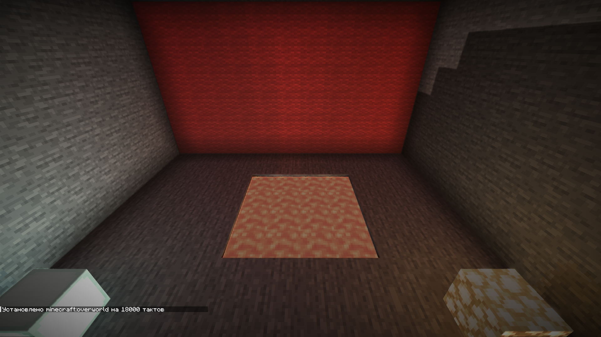

# Проходы для авторов шейдер-паков

Zenith Engine исполняет собственные полноэкранные проходы шейдер-пака: без лимитов Horizon Shader API, с доступом к воксельной сцене мода, его свету, GI и маске теней.

## Где лежат

Horizon принимает в папке пака только манифест, `.wgsl`, который используют его стадии, и текстуры. Поэтому проходы лежат **рядом с паком**:

```
shaderpacks/
  zenith_rt/                     сам пак
  .zenith-engine/
    zenith_rt/                   id пака из его манифеста
      passes.txt
      glow.wgsl
```

`passes.txt` — список проходов по порядку; они выполняются после собственных проходов мода:

```
# pass = <файл рядом> <replace | add | multiply>
pass = glow.wgsl add
```

- `add` прибавляет результат к кадру;
- `multiply` умножает кадр на результат;
- `replace` заменяет кадр результатом.

Файлы перечитываются раз в секунду, поэтому правки видны без перезапуска игры. Если шейдер не компилируется, проход отключается, а в лог игры пишется `zenith_engine: pack pass <файл> left out: ...`. Игра при этом не падает. Удачная сборка тоже отмечается в логе: `zenith_engine: pack pass <файл> ready`.

## Что пишет пак

Одну функцию:

```wgsl
fn pack_pass(pos: vec4<f32>) -> vec4<f32>
```

`pos` — позиция пикселя кадра (`@builtin(position)`). Вершинный шейдер и `@fragment` движок добавляет сам.

## Что доступно

| Имя | Что это |
|---|---|
| `u.inv_vp` | обратная view-projection кадра (с джиттером TAA), относительно камеры |
| `u.size` | ширина и высота глубины, ширина и высота кадра |
| `u.cam_block`, `u.cam_frac` | блок камеры и её положение внутри блока |
| `u.sun` | направление на солнце (ночью — на луну) |
| `u.window` | нижний угол воксельного окна 256³, в блоках |
| `u.gi` | x: сила GI, y: яркость солнца 0–1 |
| `u.misc.x` | номер кадра |
| `depth_at(px)` | глубина пикселя глубины (reversed-Z, 0 — небо) |
| `position_at(px, d)` | точка относительно камеры по пикселю глубины и глубине |
| `normal_at(px, p)` | нормаль поверхности по соседям в глубине |
| `voxel(v)` | байт вокселя в блоке `v` (мировые координаты): бит 7 — твёрдый куб, бит 6 — тонкий блок, биты 0–5 — map color; `OUTSIDE` за окном |
| `passes(c)` | сколько света пропускает воксель: 0, 0.4 (листва), 1 |
| `albedo_at(v)` | линейный цвет блока по его текстуре |
| `sky_at(v)`, `block_light_at(v)` | небесный свет и свет от блоков в клетке, 0–15 |
| `light_smooth(pos)` | свет от блоков (x) и небесный (y), 0–1, сглаженный по 8 клеткам; `pos` — от угла блока камеры |
| `sun_ray(pos, steps)` | сколько солнца доходит до `pos` по вокселям, 0–1 |
| `textureLoad(gi_result, px / 2, 0)` | GI в половинном разрешении: rgb — отскок относительно прямого света, a — расстояние |
| `textureLoad(picture, vec2<i32>(pos.xy), 0)` | кадр до этого прохода |
| `textureLoad(shadow_mask, px, 0).r` | маска теней мода: 1 — свет, 0 — тень |

Здесь `px` — пиксель глубины: `vec2<i32>(pos.xy * vec2<f32>(u.size.xy) / vec2<f32>(u.size.zw))`.

## Пример

`examples/engine/glow.wgsl` — тёплое свечение воздуха у факелов и лавы. Оно берёт сглаженный свет от блоков на полпути до поверхности и прибавляет его к кадру:

```wgsl
fn pack_pass(pos: vec4<f32>) -> vec4<f32> {
    let scale = vec2<f32>(u.size.xy) / vec2<f32>(u.size.zw);
    let px = vec2<i32>(pos.xy * scale);
    let d = depth_at(px);
    if (d <= 0.0) {
        return vec4<f32>(0.0);
    }
    let p = position_at(px, d);
    let air = light_smooth(u.cam_frac.xyz + p * 0.5);
    let glow = air.x * air.x * 0.06;
    return vec4<f32>(vec3<f32>(1.0, 0.55, 0.25) * glow, 0.0);
}
```

| Без прохода | С `glow.wgsl` |
|---|---|
|  |  |

## Ограничения

- Только полноэкранные фрагментные проходы; своих текстур, буферов и compute-проходов у пака пока нет.
- Контракт ранний: имена и привязки могут поменяться в следующих версиях мода.
- Проходы работают, только когда мод активен: включены его тени, GI или есть проходы пака.
